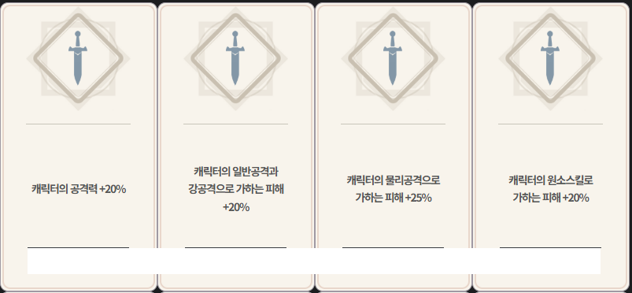

# 주의!
- 깃허브에서 보면 사진이 짤립니다.
# 게임 개요
- 작성자: 손준휘
- 작성일: 2026.10.19
## 게임 재목(가제)
- 던전 RPG
## 장르
- 어드벤처, 로그라이크
- 선택지와 전투를 통해 강해지고 엔딩까지 버티는 게임.
    - 혹은 최대한 오래 버티는 게임.
## 핵심 컨셉
1. '모험가 이야기'처럼 모험을 통해 주인공을 성장시키고 ,전투를 통해 성장을 채감하면서, 엔딩까지.
## 모험가 이야기 인게임 스크린샷
- 선택지 예시.
    1. 아이템 획득.
    2. 전투 발생.
    3. 아무 일도 일어나지 않음.
  
- 전투 화면 예시.
    - 해당 스크린샷은 구버전이어서 버프 아이콘 등이 보이지 않음.
  

# 게임 진행
## 기력
- 모바일 RPG 게임에서 흔히 등장하는 스태미나 개념입니다, 얼마나 모험을 진행할 수 있는가 나타냅니다.
- 행동에 따라 증가하거나 감소할 수 있으며 0이 되면 게임오버입니다.
## 인카운터
- 로그라이크 게임 등에서 흔한 물음표 발판 밟으면 무슨 일 발생하는 그거입니다.
- 일부는 특정 인카운터가 선행되야 하거나, 특정 시기에 고정적으로 출몰하도록 할 예정입니다.
## 선택지 선택
- 아래 사진과 같이 선택지가 제공됩니다. 마우스 클릭시 해당 선택지를 선택합니다.
  
## 전투 진행
- 일부 선택지는 선택시 전투에 진입합니다. 
- 전투는 자동으로 진행됩니다. 
- 전투 진입 전의 선택지에 따라 플레이어에게 유리하거나 불리한 효과가 적용될 수 있습니다.
  
## 전투 종료
- 전투에서 승리시 예시 이미지처럼 보상 목록이 표시되고, 이 중에서 마음에 드는 것을 마음에 드는 것을 클릭 시 해당 효과를 획득할 수 있습니다.
- 전투에서 패배시 '기력'을 소모하되 즉시 게임 오버 되지는 않도록 할 것입니다.
- 그 외에 특정 전투는 승리 시 고정 보상을 주거나 패배 시 즉시 게임 오버 등의 이벤트가 발생할 수 있습니다.
- 결과 표시 후 다음 인카운터로 넘어갑니다.

# 게임 구현
## 밸런싱
- '발더스 게이트 3', '모험가 이야기' 등 기존 게임을 참고하여 각종 수치를 조정할 것 같습니다.
    - 몇 번 맞아야 죽는지, 어떻게 수치를 조정해야 전투가 늘어지지 않는지 등.
- 밸런싱은 아이템과 몬스터를 구현하면서 같이 잡을 예정입니다.
## 캐릭터 구현
- 'character' 클래스를 상속해서 'player' 'slime', 'dog', 'golem'과 같은 객체를 구현할 것입니다.
- 오버로딩을 이용하면 부모 클래스에서 선언만 해놓은 함수들을 자식 클래스에서 수정할 수 있고, 인수로 넘길 때 자식 클래스에서만 있는 수치 같은 것들은 잘려나가지만 오버로딩된 함수나 부모 클래스의 다른 변수나 함수는 유지된는 것을 이용할 것입니다.
- `vector<effect*[]> m_effects`와 같은 멤버 리스트를 선언한 뒤 효과를 추가시키고 필요할 때 리스트를 순회하는 방식으로 여타 게임의 아이템,특성,버프 등을 구현할 예정입니다.
- 스프라이트는 대기,공격,사망의 3단계로 나누고 피격 같은 것은 RGB 값 조정, 위치 조정, 
## 효과 구현
- 효과의 발동 시점은 '림버스 컴퍼니'의 스킬 효과 적용 시점을 참고하였습니다. 
- 특정 타이밍에 발동할 효과가 있다면 PhaseIfBattleStart()와 같은 함수를 호출하여 효과를 적용하는 방식입니다.
- 기존 로그라이크에서 회복 시, 치유 시, 공격 시, 공격할 시 등 용어가 통일되어 있지 않아 혼란을 주던 것과 
    - 전투 시작 전
        - 변수를 세팅하는 등의 단계.
    - 전투 시작 시
        - 전투 중 1회만 적용되는 효과 같은 것들을 활용하는 시점.
    - 턴 시작전
    - 턴 시작시
    - 사용전
    - 사용시
    - 공격전
    - 공격 시작 시
    - 피격 시
    - 적중시
    - 사망 시
    - 적 처치 시
    - 공격 종료
    - 턴 종료시
    - 전투 종료시
- 그 외에도 인카운터 시작 시, 전투 패배 시 같은 것도 추가할 수 있을 것 같습니다.
# 개발 목표
1. ~ 10/22(thr)
    - 프로젝트 생성 및 기획 C++ 프로젝트 및 Git 저장소 생성, 게임 기획서 작성
2. ~ 10/29(thr)
    - 리소스 및 기본 구조 이미지·사운드 리소스 수집, 클래스 및 게임 기본 구조 구성
    - 이미지는 기본, 범용적인 것 위주로 수집.
    - 아이템 하나하나 같은 것은 나중에.
3. 11/05(thr)
    - 핵심 로직 구현 입력, 이동, 충돌·판정, 게임 규칙 등 핵심 플레이 구현
    - 아이템 & 이벤트 구현.

4. 11/12(thr)
    - 스테이지 확장 스테이지·난이도·콘텐츠 확장, 애니메이션 및 연출 보완  
    - 이 때까지는 게임은 완성하고 이벤트나 전투, 아이템 추가에 집중할 수 있도록 하는 것이 목표.
5. 제출일( 2026/11/30 (월) 17:00 (오후 5시))
    - 최종 제출 게임 전체 완성 및 최종 과제 평가